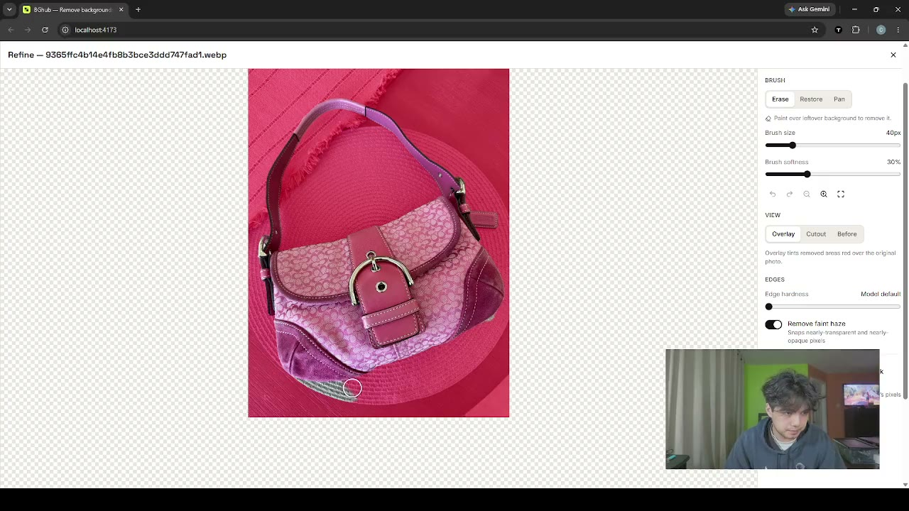

# BGhub — AI background removal that runs in your browser

**Upload. Remove. Replace. Download.**

BGhub removes the background from product photos and exports the item as a
full-resolution transparent PNG. You can then place it on a built-in or uploaded
background. Everything (decoding, AI segmentation, editing, export) runs **on
your device** in the browser. There is no account, no server-side processing
and no paid API.

## Video walkthrough

[](docs/bghub-demo.mp4)

**[▶ Watch the walkthrough](docs/bghub-demo.mp4)** (4 min 36 s): dropping in a batch of
product photos, before/after comparison, fixing edges with the brush, placing items on
new backgrounds in the Studio, and downloading the results.

## Features

- Batch processing: drop any number of photos and keep adding while they run
- JPEG, PNG, WebP, **HEIC/HEIF**, AVIF, TIFF, BMP, GIF (first frame)
- Output keeps the original pixel dimensions; the item's pixels are never repainted
- Per-image status, retry, cancel, remove; individual PNG or ZIP downloads (all or selected)
- Before/after comparison and a mask brush (erase / restore, undo / redo, edge hardness)
- Background Studio: 32 procedurally generated backgrounds (concrete, studio, brick,
  graffiti, plaster, metal, grunge, painted wall, paper, solids, gradients) or your own
  photo; scale, position, drag, optional shadow; PNG or JPEG export
- Light/dark theme, keyboard accessible, works on phones

---

## How it works

```
File ─► header check (format sniffing, dimension limits)          main thread
     ─► decode → RGBA at original size, EXIF/HEIF rotation         image worker
     ─► 1024×1024 copy → normalised tensor                         image worker
     ─► BiRefNet-lite segmentation (WebGPU, else WebAssembly)      model worker(s)
     ─► mask resized to original size (bilinear) → light cleanup   image worker
     ─► alpha = source alpha × mask, RGB untouched → lossless PNG  image worker
```

- **Two worker pools.** Image workers (decode/export) and model workers (one ONNX Runtime
  session each). Decoding and exporting overlap with inference. The number of images
  analysed *at the same time* is a setting (1–3, default 2 on devices with ≥8 GB RAM),
  because each model copy needs ~0.5–1.5 GB. New files are always accepted immediately;
  the card says "Waiting for a free model slot" only when every slot is busy.
- **No resizing of the result.** The model sees a 1024² copy; its mask is scaled back
  to the decoded size and applied to the original pixels. Fully transparent pixels have
  RGB zeroed (invisible) for smaller files; every visible pixel keeps its exact RGB.
- **Exact alpha.** PNGs are encoded with `fast-png` from straight RGBA, not
  `canvas.toBlob`, which would quantise colours of semi-transparent edge pixels.
- **Colour.** Browser-decoded formats are converted to sRGB by the browser. HEIC
  decoded by libheif (non-Safari browsers) is not colour-managed; the card says so.

## AI model

| | |
|---|---|
| Model | **BiRefNet-lite** (Bilateral Reference for High-Resolution Dichotomous Image Segmentation), Peng Zheng et al. |
| Weights | `onnx-community/BiRefNet_lite-ONNX`, file `onnx/model_fp16.onnx`, **revision `de15b22ba131738a16dff04aab8bdf8dc32e3ac1`**, SHA-256 `d39b897c…bec402` |
| Upstream | https://github.com/ZhengPeng7/BiRefNet · https://huggingface.co/ZhengPeng7/BiRefNet_lite |
| License | **MIT** (model card and repository). MIT permits commercial use; keep the copyright/licence notice when redistributing the weights. |
| Runtime | ONNX Runtime Web 1.30.0 (MIT) — native WebGPU EP (`ort.webgpu`) or WebAssembly SIMD + threads (`ort.wasm`) |
| Download | ~101.6 MB model + 26.8 MB (WebGPU runtime) or 14.2 MB (CPU runtime), cached in Cache Storage after the first visit |
| Input | 1024×1024 RGB, ImageNet mean/std; output: 1024×1024 logits → sigmoid |

### Browser-compatibility rewrite (`scripts/patch-model.py`)

The upstream ONNX export does not run in browsers as-is. The build rewrites the graph
**without changing any weights**:

1. **Deformable convolutions.** The export expands torchvision's `deform_conv2d` into
   GatherND/Transpose chains producing dozens of 400–800 MB tensors (≈6 GB peak on CPU),
   beyond the 4 GB heap of 32-bit WebAssembly. All 20 are replaced by single ONNX
   `DeformConv` (opset 22) nodes with the same input, offsets, modulation mask, weight
   and bias. Peak CPU memory drops to ≈1.5 GB.
2. **Wide Split/Concat** (up to 32 outputs / 1024 inputs) are rewritten as small trees,
   because many GPUs allow only 16 storage buffers per WebGPU shader.
3. **Sum** (no WebGPU kernel) becomes a tree of `Add`s.

`scripts/verify-patch.mjs` runs the original and rewritten models on a real photo and
fails the build if any 8-bit alpha value differs by more than 3/255 (measured: logits
Δ ≤ 0.066, alpha Δ ≤ 3/255 for fp16; ≤ 1/255 for fp32). The rewritten model is split
into 20 MB chunks and served from BGhub's own origin, verified by SHA-256 in the
browser before it is cached.

### Known model limitations (tested on real photos, see "Testing")

- Dark items on dark backgrounds can lose parts (headphones on a dark desk were only
  partially kept).
- With several prominent things (e.g. sneakers worn with sweatpants) the model keeps
  everything it considers the subject; erase extras with the brush. There is no
  subject-selection dropdown because the model has no per-object output.
- Transparent objects (glass) are kept as opaque cutouts; what is behind the glass in
  the photo stays visible inside it.
- Results are predictions, not guarantees; BGhub warns when the mask looks empty, covers
  almost everything, or is uncertain over large areas.

## Testing

| Suite | Command | Result (this build) |
|---|---|---|
| Unit + image processing (formats, HEIC detection, limits, filenames, mask resize/refine, RGBA/PNG round trip, alpha preservation, compositing math, ZIP collisions, batch counts, textures) | `npm test` | 60/60 pass |
| End-to-end, real model, production build, Chrome (desktop + Pixel 7 emulation) | `npm run test:e2e` | 10/10 pass |
| Model rewrite equivalence | runs inside `npm run assets` | max Δalpha 3/255 |

The E2E flow covers: no-login home page; SVG/text/60000×60000 rejections; JPEG → PNG
download (960×857 RGBA, "Resized: No"); compare dialog; a batch with images added while
others are analysing; independent states; HEIC (incl. rotated and multi-image) decode;
EXIF-rotated JPEG; corrupt-file isolation; cancel + retry; ZIP contents; mask brush;
studio presets, custom HEIC background, scale/position, PNG and JPEG export, the
unchanged transparent PNG; zero cross-origin requests; no horizontal scroll on mobile.

Note: in the automated Chrome used for testing, saving files larger than ~2 MB to disk
was cancelled by the browser environment (also with a plain 2 MB test blob), so the ZIP
and studio exports are verified by reading the bytes behind the "Save" link.

### Real photos (BiRefNet-lite, this build)

| Photo | Result |
|---|---|
| Tooled leather handbag (900×870) | Clean, including thin handles |
| Denim jacket (1920×1714) | Clean |
| Black garment on fabric (1920×1277) | Clean |
| Street sign on busy street (1920×1440) | Sign and pole isolated, street removed |
| Sneakers + sweatpants on purple (5184×3007) | Shoes **and** legs kept (both treated as subject) |
| Black headphones + phone on dark desk | Partial: parts of the headphones missing |
| Glass (transparent object) | Kept as an opaque cutout |

### Measured performance (Intel i7-12700H laptop, Iris Xe graphics, 16 GB)

| | |
|---|---|
| First visit download | 101.6 MB model + 26.8 MB (GPU) / 14.2 MB (CPU) runtime |
| Model start (cached) | 8–15 s |
| Inference, WebGPU (Iris Xe), 1 at a time | 12–21 s per image (first image +shader compile, ~36 s) |
| Inference, WebAssembly 8 threads | ~17 s per image |
| Batch of 4 (CPU, 2 at a time) | 65–78 s |
| 15.6 MP photo (5184×3007) | decode 1.6 s, inference 24.5 s, PNG export 12 s, output 5184×3007 9.5 MB |
| Memory, 4 rounds × 4 images, cleared between rounds | 1.0–2.3 GB browser working set, no upward trend |

Discrete GPUs are expected to be considerably faster; these numbers are from one machine.

## Running locally

Requirements: Node.js 20+ (tested with 24.22), npm, and — **only for the first build** —
Python 3 with `pip install onnx numpy` (used once to rewrite the model; the result is
cached in `.cache/`).

```bash
npm install
npm run dev          # downloads + prepares the model on first run, then http://localhost:5173
```

| Command | What it does |
|---|---|
| `npm run dev` | Prepare assets, start Vite dev server (COOP/COEP headers on) |
| `npm run build` | Prepare assets, type-check, production build to `dist/`, run `scripts/check-dist.mjs` (no file > 25 MiB, all model chunks present) |
| `npm run preview` | Serve `dist/` on http://localhost:4173 |
| `npm test` | Unit + image-processing tests (Vitest) |
| `npm run test:e2e` | End-to-end tests (Playwright, uses your installed Google Chrome) against `npm run preview` |
| `npm run lint` / `npm run typecheck` | ESLint / TypeScript |

`npm run assets` (run automatically by `dev` and `build`) downloads the pinned model from
Hugging Face, checks its SHA-256, rewrites and verifies it, and writes `public/bin/`.
Nothing in `public/bin/` is committed.

## Deploying for free (Cloudflare Pages)

Cloudflare Pages is used because it serves static files with custom headers. BGhub needs
`Cross-Origin-Opener-Policy`/`Cross-Origin-Embedder-Policy` (multi-threaded WebAssembly)
and sets a strict Content-Security-Policy; both live in `public/_headers`.

1. Create a free Cloudflare account (no card required for Pages).
2. Log in once on your machine: `npx wrangler login` (opens your browser).
3. Deploy:

   ```bash
   npm run build
   npx wrangler pages deploy dist --project-name bghub
   ```

   The first run creates the project and prints a URL like `https://bghub.pages.dev`.
4. Redeploy after changes with the same two commands.

**Free-tier notes (Cloudflare Pages, as documented at the time of writing):** unlimited
static requests and bandwidth, 500 builds/month (not used — we upload a prebuilt
`dist/`), max 20,000 files and 25 MiB per file per deployment. BGhub ships 33 files,
~139 MiB total, largest 20 MiB. No paid service, database, storage or GPU is involved;
all compute happens in visitors' browsers.

**Custom domain:** Pages project → *Custom domains* → add your domain and follow the DNS
steps. No code change is needed (all asset paths are relative).

GitHub Pages also works for the files, but it cannot send COOP/COEP headers, so the CPU
path would run single-threaded (much slower). WebGPU is unaffected.

## Browser requirements

- **Fast path:** WebGPU with `shader-f16` (current Chrome/Edge on desktop and Android,
  Safari 26+, recent Firefox on supported platforms).
- **Fallback:** any current browser with WebAssembly SIMD; multi-threaded when the page
  is cross-origin isolated (it is on Cloudflare Pages and in `npm run dev/preview`).
- About 2 GB of free memory per model copy is recommended. iPhone/iPad are limited to
  16 MP images (Safari canvas limit); desktop to 50 MP; both configurable in
  `src/lib/limits.ts`.

## Privacy & security

- Images are processed only in the browser. The CSP is `connect-src 'self'`: the page
  cannot send requests to any other origin. The end-to-end suite asserts that a full
  session makes **zero** cross-origin requests.
- Nothing is stored persistently except the model/runtime files (Cache Storage) and the
  theme choice (localStorage). Images live in memory; "Remove"/"Clear completed" release
  them, and closing the tab discards everything (the page warns before leaving).
- Files are validated by signature (not extension) and header dimensions before
  decoding; SVG is rejected; oversized/decompression-bomb images are refused per file.
- Filenames are rendered as text only and sanitised for downloads.
- Settings → "Delete downloaded model" clears the cached model.

## Customising

**Add a background preset:** add an entry to `src/features/studio/presets.ts`. Either
`flat: true` with a `draw(ctx, w, h)` that fills a colour/gradient, or a procedural
texture using the helpers in `textures.ts` (seeded, so preview and export match). To use
an image file, put a licensed image in `public/backgrounds/` and draw it with
`ctx.drawImage` after loading it once.

**Replace or update the model:** change `MODEL` in `scripts/prepare-assets.mjs`
(repository, revision, file, SHA-256). The model must take one `1×3×S×S` float input
and output `1×1×S×S` logits; adjust `MODEL_SIZE`/normalisation in
`src/lib/preprocess.ts` if different. `patch-model.py` only rewrites patterns it finds,
and `verify-patch.mjs` will fail the build if a rewrite changes the output.

## Troubleshooting

| Problem | Fix |
|---|---|
| "The AI model could not start" | Update the browser; try Settings → Compute → CPU; reload. |
| Tab crashes on big batches | Settings → "Images analysed at once" → 1. |
| Very slow | No WebGPU → CPU path (≈15–30 s/image on a laptop). Use Chrome/Edge with a GPU. |
| HEIC fails | The file may use an unsupported codec variant; export as JPEG from Photos. |
| Model download interrupted | Retry; partial downloads are never cached (SHA-256 check). |
| `npm run assets` fails at "patch" | `pip install onnx numpy`, or set `PYTHON=/path/to/python`. |

## Project layout

```
src/
  engine/      engine.ts (job store, scheduling, worker pools), assets.ts (chunked model
               download + cache), protocol.ts, types.ts
  workers/     image.worker.ts (decode/prepare/export), model.worker.ts (ONNX Runtime)
  lib/         formats, validate, limits, decode (incl. HEIC/TIFF), preprocess, mask,
               png, compose, filenames, zip, batch
  features/    upload/, results/, editor/ (mask brush), studio/ (backgrounds, compositing)
  components/  Header, Help, Settings, ui primitives
scripts/       prepare-assets, patch-model.py, verify-patch, check-dist, model-eval, …
tests/         unit/ (Vitest), e2e/ (Playwright), fixtures/ (CC0 photos, HEIC, edge cases)
```

## Licences & credits

- BGhub source: MIT.
- BiRefNet / BiRefNet-lite weights: MIT, © Peng Zheng et al.
- ONNX Runtime Web: MIT, © Microsoft. fflate, fast-png, UTIF.js, lucide: MIT/ISC.
- libheif-js (HEIC decoding, loaded on demand): LGPL-3.0, shipped unmodified as a
  separate file; source: https://github.com/catdad-experiments/libheif-js. HEVC decoding
  may be subject to patents in some jurisdictions.
- Inter and Space Grotesk fonts: SIL Open Font License.
- Test photos: CC0 from Wikimedia Commons (`tests/fixtures/ATTRIBUTION.md`).
